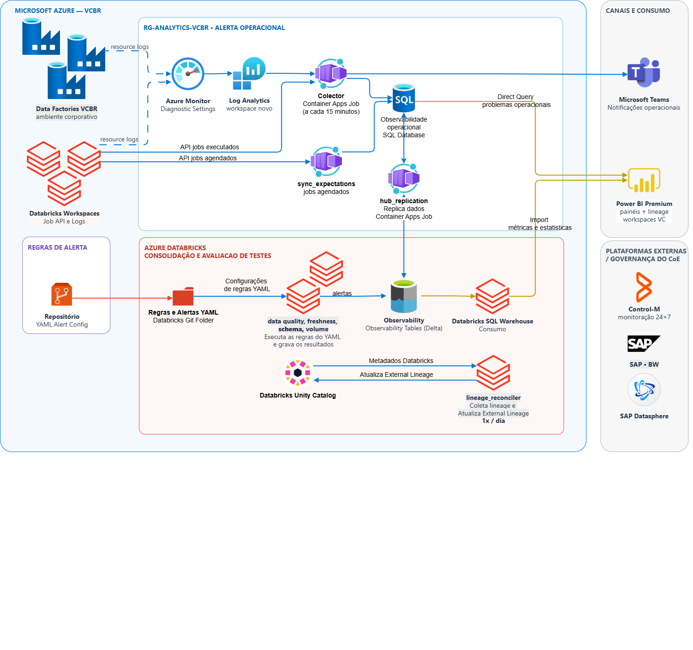
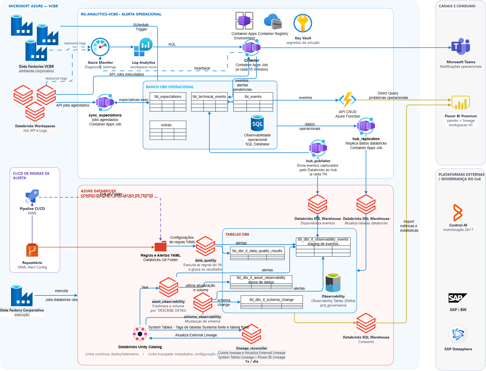
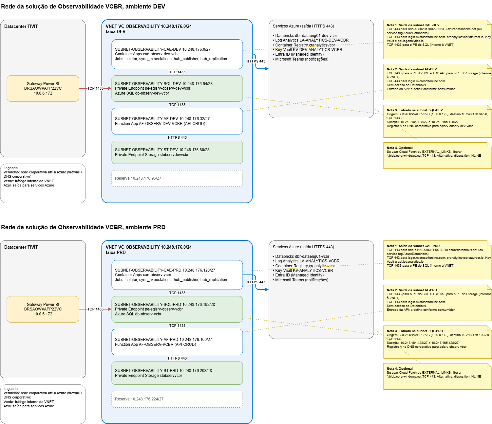

# Observabilidade

## Repositórios da solução

A solução é implantada em mais de um repositório do Azure DevOps (projeto `VC-ANALYTICS`). Este repositório, `dbr-dataeng01-vcbr-platform`, guarda o código dos jobs Databricks, a configuração de negócio em YAML e **a documentação principal da solução**: especificações, arquitetura, conceito e diagramas. Os outros repositórios guardam código de implantação e de execução.

| Repositório | Conteúdo |
|---|---|
| `dbr-dataeng01-vcbr-platform` (este) | Jobs Databricks (`asset_observability`, `data_quality`, `schema_observability`, `custom_lineage_reconciler`), configuração dos jobs Databricks em `solutions/observability/config/` (regras de qualidade por domínio e ativos monitorados), scripts de Diagnostic Settings, SQL do hub, documentação |
| `cae-observ-vcbr` | Container Apps Jobs: `observability-collector`, `sync-expectations`, `hub-publisher` e `hub-replication`, além da cópia de `event_resolution.py` |
| `AF-OBSERV-VCBR` | API `observability-api` (Azure Functions, Flex Consumption) |

A documentação de cada módulo fica aqui, mesmo quando o código está em outro repositório. Cada especificação indica o repositório onde o código está ou vai estar.

## O que a solução faz

A Votorantim Cimentos depende de dados para operar e decidir, mas os sinais que indicam se esses dados estão disponíveis, completos e confiáveis estão espalhados entre ADF, Databricks, Unity Catalog e Power BI. Muitos problemas não produzem erro explícito: o processo não executou, a tabela não foi atualizada no prazo, a carga veio vazia ou o volume variou de forma anormal. Hoje, esses casos costumam ser descobertos pelo consumidor.

A solução reúne esses sinais em um **hub operacional** em banco SQL. Cada incidente é um registro com estado `OPEN` ou `RESOLVED`, o que permite deduplicar, correlacionar e fechar incidentes automaticamente. As notificações saem pelo Microsoft Teams, e o Power BI consome o estado pelo hub.

Os tipos de sinal cobertos são:
- falha de execução em ADF e Databricks;
- ausência de execução e job travado;
- freshness e volume das tabelas Delta;
- resultados de regras de Data Quality, com separação entre erro técnico e dado reprovado;
- mudança de schema;
- lineage externo (SAP BW e Datasphere) no Unity Catalog.

## Princípios

- **Hub transacional, não regra de alerta recalculada.** O estado do incidente mora em uma linha de banco. Dedup, correlação e fechamento dependem disso.
- **Latência determinística.** O coletor consulta a fonte da verdade (Jobs API e Log Analytics) na cadência que ele controla, sem depender de uma fonte gerenciada sem SLA.
- **Jobs Databricks não falam com o hub.** Eles gravam eventos em uma tabela de staging Delta. O `hub-publisher` envia esses eventos ao hub, em um único caminho de escrita.
- **Configuração separada da execução.** A configuração dos jobs Databricks (regras de qualidade e ativos) fica em YAML versionado, revisado por pull request. A dos Container Apps Jobs (destinos e regras de alerta, expectativas manuais, workspaces) fica em tabelas do hub, mantidas pela `observability-api`. Resultados ficam em tabela.
- **Resolução em Python, sem stored procedure.** `resolve_event()` decide a mudança de estado dentro de uma transação, e é compartilhado entre o coletor e o publicador.

## Componentes

**Hub e núcleo**
- Hub operacional em Azure SQL Database, com schema e views em `src/azure-sql/`. Ver [01](Especs/01-Hub-Azure-SQL.md).
- Resolução de eventos, `resolve_event()`. Ver [02](Especs/02-Resolucao-de-Eventos.md).

**Container Apps Jobs** (repositório `cae-observ-vcbr`)
- `observability-collector`, a cada 15 minutos. Coleta falhas do Databricks e do ADF, avalia ausência de execução, envia notificações e grava um heartbeat. Ver [10](Especs/10-Job-observability-collector.md).
- `sync-expectations`, diário. Preenche as expectativas de execução a partir dos agendamentos do Databricks e do ADF; jobs de agendadores externos (Control-M) são cadastrados pela API. Ver [11](Especs/11-Job-sync-expectations.md).
- `hub-publisher`, de hora em hora, no minuto 0. Lê a staging Delta e envia os eventos ao hub. Ver [12](Especs/12-Job-hub-publisher.md).
- `hub-replication`, de hora em hora, no minuto 15. Replica o hub para Delta, para histórico de dois anos. Ver [13](Especs/13-Job-hub-replication.md).

**Azure Functions** (repositório `AF-OBSERV-VCBR`)
- `observability-api`. Leitura de incidentes e CRUD das tabelas de configuração. Não grava incidentes. Ver [30](Especs/30-Azure-Functions-observability-api.md).

**Processos Databricks** (este repositório, em `solutions/observability/src/vc_observability/`)
- `asset_observability`, diário. Freshness por `DESCRIBE DETAIL`, volume por `COUNT(*)` e métricas por commit. Ver [20](Especs/20-Databricks-asset_observability.md).
- `data_quality`, disparado pelo ADF uma vez por domínio. Executa as regras declaradas em YAML na pasta do domínio. Ver [21](Especs/21-Databricks-data_quality.md).
- `schema_observability`, diário. Compara snapshots de `INFORMATION_SCHEMA` e classifica as mudanças. Ver [22](Especs/22-Databricks-schema_observability.md).
- `custom_lineage_reconciler`, uma a duas vezes por dia. Registra a origem externa de cada tabela no Unity Catalog. Ver [23](Especs/23-Databricks-custom_lineage_reconciler.md).

**Configuração e operação**
- YAML de configuração de negócio, em `solutions/observability/config/`, com uma pasta por domínio. Ver [40](Especs/40-Configuracao-YAML.md).
- Scripts que ativam os Diagnostic Settings do ADF e dos workspaces Databricks no Log Analytics. Ver [50](Especs/50-Scripts-Diagnostic-Settings.md).

## Pipelines de origem

Pergunta de operação: *como operação, quero conhecer pipelines críticos para priorizar monitoramento.*

A tabela abaixo é a resposta da operação, com os pipelines críticos. Ela é um recorte da lista completa que vem depois.

| Nome do ADF | Nome do Pipeline | Periodicidade de Execução | Disparador | Nome do Job |
|---|---|---|---|---|
| DF-VENDM-INTG-PRD-VCBR | pip_copy_qliksense_files_daily | Diário às 20:30 | ControlM | NR_VC_DF_DI_0230_DF_VENDM_INTG |
| DF-VENDM-INTG-PRD-VCBR | pip_copy_qliksense_files_hourly | De hora em hora, das 06:00 às 20:00 | ControlM | NR_VC_HR_DF_VENDM_INTG |
| df-bateulevou-prd-vcbr | pip_copy_qliksense_files_daily | Diário às 06:00 | ControlM | NR_VC_DF_DI_0600_BATEULEVOU_QLK |
| DF-PIOSI-VCBR | PIP_ING_RAW_PIOSI_TAGS | A cada 15 minutos | TriggerADF | TRG_ING_RAW_PIOSI_TAGS |
| DF-PIOSI-VCBR | PIP_ING_CLEANSED_PIOSI_TAGS | A cada 1 hora | TriggerADF | TRG_ING_CLEANSED_PIOSI_TAGS |
| DF-PIOSI-VCBR | PIP_ING_TAGS_LABORATORIO | A cada 2 horas | TriggerADF | TRG_ING_RAW_CLEANSED_PIOSI_TAGS_LAB_UFL |
| DF-PIOSI-VCBR | PIP_ING_TAGS_LABORATORIO | Diário às 23:00 | TriggerADF | TRG_ING_RAW_CLEANSED_PIOSI_TAGS_LAB_UFL_2 |
| DF-LOGISTICS-VCBR | pip_geral_shouldcost | Diário às 08:00 | TriggerADF | trig_pip_Geral_ShouldCost |

### Inventário completo dos pipelines em execução

Levantamento de todos os pipelines ADF em execução, agrupados por Data Factory. A coluna "Disparador" mostra quem dispara cada pipeline: `ControlM` ou `TriggerADF`.

| Nome do ADF | Nome do Pipeline | Periodicidade de Execução | Disparador | Nome do Job |
|---|---|---|---|---|
| DF-VENDM-INTG-PRD-VCBR | pip_copy_qliksense_files_daily | Diário às 20:30 | ControlM | NR_VC_DF_DI_0230_DF_VENDM_INTG |
| DF-VENDM-INTG-PRD-VCBR | pip_copy_qliksense_files_hourly | De hora em hora, das 06:00 às 20:00 | ControlM | NR_VC_HR_DF_VENDM_INTG |
| df-bateulevou-prd-vcbr | pip_copy_qliksense_files_daily | Diário às 06:00 | ControlM | NR_VC_DF_DI_0600_BATEULEVOU_QLK |
| DF-COMERCIAL-VCBR | RUN_DAY_PIPELINES | Semanal, de segunda a sábado às 08:30 UTC | TriggerADF | RUN_DAY |
| DF-COMERCIAL-VCBR | A1 MKP Report Execucao Diaria | Diário às 04:00 | TriggerADF | Relatorio MKP Five9 Diario |
| DF-COMERCIAL-VCBR | RUN_60_MINUTES_PIPELINES | Diário, de hora em hora das 03:30 às 23:30 | TriggerADF | 60Min |
| DF-COMERCIAL-VCBR | RUN_12_HORAS_PIPELINES | Diário às 11:50 e 23:50 | TriggerADF | 12Horas |
| DF-COMERCIAL-VCBR | COPY_MULTI_CHANNEL_ALL_REPAIR | Por evento de blob | TriggerADF | REPAIR_MULT_CHANNEL |
| DF-COMERCIAL-VCBR | COPY_IVR_MODULE_REPAIR | Por evento de blob | TriggerADF | REPAIR_IVR_MODULE |
| DF-COMERCIAL-VCBR | COPY_CONTACT_ALL_REPAIR | Por evento de blob | TriggerADF | REPAIR_CONTACT_REPORT |
| DF-COMERCIAL-VCBR | COPY_ACD_ALL_REPAIR | Por evento de blob | TriggerADF | REPAIR_ACD_REPORT |
| DF-COMERCIAL-VCBR | COPY_CALL_SEGMENT_ALL_REPAIR | Por evento de blob | TriggerADF | REPAIR_CALL_SEGMENT |
| DF-COMERCIAL-VCBR | COPY_AGENT_ALL_REPORT_REPAIR | Por evento de blob | TriggerADF | REPAIR_AGENTE_REPORT |
| DF-COMERCIAL-VCBR | COPY_TEXT_ALL_REPAIR | Por evento de blob | TriggerADF | REPAIR_TEXT_REPORT |
| DF-COMERCIAL-VCBR | COPY_IVR_ALL_REPAIR | Por evento de blob | TriggerADF | REPAIR_IVR_REPORT |
| DF-COMERCIAL-VCBR | COPY_DNC_ALL_REPAIR | Por evento de blob | TriggerADF | REPAIR_DNC_REPORT |
| DF-COMERCIAL-VCBR | COPY_DNIS_ALL_REPAIR | Por evento de blob | TriggerADF | REPAIR_DNIS_REPORT |
| DF-COMERCIAL-VCBR | COPY_CALL_ALL_REPAIR | Por evento de blob | TriggerADF | REPAIR_CALL_REPORT |
| DF-COMERCIAL-VCBR | COPY_LIST_ALL_TO_SQLDB_REPAIR | Por evento de blob | TriggerADF | REPAIR_LIST_REPORT |
| DF-COMERCIAL2-VCBR | PIP_ING_IVR | Diário às 00:10 e 12:10 | TriggerADF | TRG_PIP_ING_IVR_REPORT |
| DF-COMERCIAL2-VCBR | PIP_ING_MKP_REPORT | Diário às 00:10 e 12:10 | TriggerADF | TRG_PIP_ING_MKP_REPORT |
| DF-COMERCIAL2-VCBR | PIP_ING_TEXT_REPORT | Diário às 00:10 e 12:10 | TriggerADF | TRG_PIP_ING_TEXT_REPORT |
| DF-COMERCIAL2-VCBR | PIP_ING_ACD_REPORT | Diário às 04:00 e 16:00 | TriggerADF | TRG_PIP_ING_ACD_REPORT |
| DF-COMERCIAL2-VCBR | PIP_ING_SEGMENT_REPORT | Diário às 01:00 e de hora em hora das 04:00 às 19:00 | TriggerADF | TRG_PIP_ING_SEGMENT_REPORT |
| DF-COMERCIAL2-VCBR | PIP_ING_AGENT_REPORT | A cada 1 hora | TriggerADF | TRG_PIP_ING_AGENT_REPORT |
| DF-COMERCIAL2-VCBR | PIP_ING_CALL_REPORT | Diário às 01:00 e de hora em hora das 04:00 às 19:00 | TriggerADF | TRG_PIP_ING_CALL_REPORT |
| DF-CONTROL-VCBR | Diario_OBZ | Diário às 06:00 | TriggerADF | trigger_obz |
| DF-CONTROL-VCBR | Diario_Cash_Cost | Diário às 06:00 | TriggerADF | trigger_cash_cost |
| DF-CORPORATIVO-VCBR | pip_opendata_daily | Diário às 18:00 | TriggerADF | trg_daily_18h |
| DF-CORPORATIVO-VCBR | pip_opendata_montly_d15 | Mensal, dia 15 às 19:00 | TriggerADF | trg_montly_d15_19h |
| DF-CORPORATIVO-VCBR | pip_ingest_anp | Semanal, terça às 13:00 | TriggerADF | Trg_pip_anp |
| DF-CORPORATIVO-VCBR | pip_geral_masterdata | Diário às 07:00 | TriggerADF | trig_pip_Geral_Masterdata |
| DF-ENGEMIX-VCBR | EfConcretoBetontecDiario | Diário às 01:00 | TriggerADF | engemix_ef_concreto_exec_diaria |
| DF-ENGEMIX-VCBR | pipeline ingestion DBCOMMAND full 15min | A cada 15 minutos | TriggerADF | engemix_datalake_15min |
| DF-ENGEMIX-VCBR | pipeline ingestion DBCOMMAND full horario | A cada 1 hora | TriggerADF | engemix_datalake_horario |
| DF-ENGEMIX-VCBR | pipeline ingestion DBCOMMAND incremental horario | A cada 1 hora | TriggerADF | engemix_datalake_horario |
| DF-ENGEMIX-VCBR | pipeline Data Lake Engemix | Semanal, todos os dias às 00:30 | TriggerADF | engemix_datalake |
| DF-ENGEMIX-VCBR | Execute_Cepro | Semanal, todos os dias às 00:30 | TriggerADF | engemix_datalake |
| DF-ENGEMIX-VCBR | Execute_Gestao_Veicular | Semanal, todos os dias às 00:30 | TriggerADF | engemix_datalake |
| DF-ENGEMIX-VCBR | Execute_Manutencao | Semanal, todos os dias às 00:30 | TriggerADF | engemix_datalake |
| DF-ENGEMIX-VCBR | Execute_Sistemas | Semanal, todos os dias às 00:30 | TriggerADF | engemix_datalake |
| DF-ENGEMIX-VCBR | Execute_GoTo_30min | A cada 45 minutos | TriggerADF | engemix_goto_30min |
| DF-ENGEMIX-VCBR | Execute_Goto_diario | Diário às 03:00 UTC | TriggerADF | engemix_goto_diario |
| DF-ENGEMIX-VCBR | Exec_curated2sqlForPonto | Diário às 14:00 | TriggerADF | engemix_forponto_diario |
| DF-ENGEMIX-VCBR | PIP_ING_broBot | Diário às 03:00 | TriggerADF | engemix_brobot_diario |
| DF-ENGEMIX-VCBR | PIP_ING_GENU | Diário, início 00:30, sem agendamento de hora explícito | TriggerADF | tgr_pip_ing_genu_test |
| DF-GENTE-VCBR | execute_srh_diario | Por evento de blob em /raw/blobs/Gente/dlakevsa/SRH/Process/ | TriggerADF | trg_srh_diaria |
| DF-GENTE-VCBR | execute_forponto_mensal | Mensal, dia 20 às 12:00 | TriggerADF | trg_forponto_mensal |
| DF-GENTE-VCBR | execute_forponto_diaria | Diário às 12:00 | TriggerADF | trg_forponto_diaria |
| DF-INDUSTRIAL-VCBR | 30m_copia_tags_piosi | A cada 30 minutos (parada) | TriggerADF | Pi_OSI_30_em_30_min |
| DF-INDUSTRIAL-VCBR | diario_processa_tags_vcbr_raw2cleansed | Diário às 01:00 (parada) | TriggerADF | PI_OSI_Diario_1AM |
| DF-INDUSTRIAL-VCBR | mensal_processa_tags_vcbr_raw2cleansed | Mensal, dia 1 às 09:00 (parada) | TriggerADF | PIOSIConsolidacaoMensal |
| DF-INDUSTRIAL-VCBR | diario_copia_tags_piosi_dualmining | Diário às 00:10 (parada) | TriggerADF | trg_diario_copia_tags_piosi_dualmining |
| DF-LOGISTICS-VCBR | pip_gp_main | Diário às 01:00 | TriggerADF | trg_gestao_patio_delta_diario |
| DF-LOGISTICS-VCBR | pip_geral_shouldcost | Diário às 08:00 | TriggerADF | trig_pip_Geral_ShouldCost |
| DF-LOGISTICS-VCBR | Ingest_TRANSPORTES_ADHOC_QLIKSENSE | Diário às 10:00 (parada) | TriggerADF | FCF diario |
| DF-LOGISTICS-VCBR | PIP_DATASPHERE_03H_15H | Diário às 03:00 e 15:00 | TriggerADF | trg_datasphere_03H_15H |
| DF-MANUTENCAO-VCBR | PIP_ING_ZGLPM128_API2RAW | Diário às 05:00 | TriggerADF | trg_manutencao_kpi_diaria |
| DF-MANUTENCAO-VCBR | PIP_ING_IW29_API2RAW | Diário às 05:00 | TriggerADF | trg_manutencao_kpi_diaria |
| DF-MANUTENCAO-VCBR | PIP_ING_IW39_API2RAW | Diário às 05:00 | TriggerADF | trg_manutencao_kpi_diaria |
| DF-MANUTENCAO-VCBR | PIP_ING_ACM_ACOES_SHAREPOINT2RAW | Diário às 05:00 | TriggerADF | trg_manutencao_kpi_diaria |
| DF-MANUTENCAO-VCBR | PIP_ING_ACM_GATILHO_SHAREPOINT2RAW | Diário às 05:00 | TriggerADF | trg_manutencao_kpi_diaria |
| DF-MANUTENCAO-VCBR | PIP_ING_DIMENSOES_SHAREPOINT2RAW | Diário às 05:00 | TriggerADF | trg_manutencao_kpi_diaria |
| DF-MANUTENCAO-VCBR | PIP_ING_IW49N_API2RAW | Diário às 05:00 | TriggerADF | trg_manutencao_kpi_diaria |
| DF-MANUTENCAO-VCBR | PIP_ING_MB51_API2RAW | Diário às 05:00 | TriggerADF | trg_manutencao_kpi_diaria |
| DF-MANUTENCAO-VCBR | PIP_ING_ME2K_API2RAW | Diário às 05:00 | TriggerADF | trg_manutencao_kpi_diaria |
| DF-MANUTENCAO-VCBR | PIP_ING_ME2N_API2RAW | Diário às 05:00 | TriggerADF | trg_manutencao_kpi_diaria |
| DF-MANUTENCAO-VCBR | PIP_ING_BASE_QL_SHAREPOINT2RAW | Diário às 05:00 | TriggerADF | trg_manutencao_kpi_diaria |
| DF-MINING-VCBR | sascar_download_to_raw_hora_hora | A cada 1 hora, UTC (parada) | TriggerADF | Hora em hora |
| DF-MINING-VCBR | Pl_Orquestracao | Diário às 06:00 e 13:00 | TriggerADF | Trigger_Industrial_Mining |
| DF-PIOSI-VCBR | PIP_ING_CLEANSED_PIOSI_TAGS | A cada 1 hora | TriggerADF | TRG_ING_CLEANSED_PIOSI_TAGS |
| DF-PIOSI-VCBR | PIP_ING_RAW_PIOSI_TAGS | A cada 15 minutos | TriggerADF | TRG_ING_RAW_PIOSI_TAGS |
| DF-PIOSI-VCBR | PIP_ING_RAW_CLEANSED_PIOSI_DESCRICOES | Semanal, domingo às 04:00 | TriggerADF | TRG_ING_RAW_CLEANSED_PIOSI_Descricoes |
| DF-PIOSI-VCBR | PIP_REGRA_CURATED_PIOSI_FATO_PROD_VIG | Diário às 07:00 | TriggerADF | TRG_REGRA_CURATED_PIOSI_FATO_PROD_VIG |
| DF-PIOSI-VCBR | PIP_ING_TAGS_LABORATORIO | A cada 2 horas | TriggerADF | TRG_ING_RAW_CLEANSED_PIOSI_TAGS_LAB_UFL |
| DF-PIOSI-VCBR | PIP_ING_TAGS_LABORATORIO | Diário às 23:00 | TriggerADF | TRG_ING_RAW_CLEANSED_PIOSI_TAGS_LAB_UFL_2 |
| DF-PIOSI-VCBR | PIP_ING_INDUSTRIAL | Diário às 03:00 UTC | TriggerADF | TRG_ING_PLANILHAS_VCSM |
| DF-PIOSI-VCBR | CreateProjectTables | Diário às 00:00 | TriggerADF | TRG_CREATE_TABLES_PROJETOS |
| DF-PIOSI-VCBR | CreateProjectTables | Diário às 07:00 | TriggerADF | TRG_CREATE_TABLES_PROJETOS2 |
| DF-PIOSI-VCBR | PIP_QUALIDADE_INDICADOR_SETE | Diário às 03:30 | TriggerADF | TRG_QUALIDADE_INDICADOR_SETE |
| DF-PIOSI-VCBR | PIP_ING_VCMS_COMPLETE | Diário às 03:00, 07:00, 11:00, 15:00, 19:00 e 23:00 | TriggerADF | TRG_ING_VCMS |
| DF-PIOSI-VCBR | PIP_ING_SHAREPOINT | Semanal, domingo às 18:00 | TriggerADF | TRG_ING_SHAREPOINT |
| DF-PIOSI-VCBR | PIP_ING_RAW_PIOSI_SKF | A cada 30 minutos | TriggerADF | TRG_ING_RAW_PIOSI_SKF |
| DF-PUBLIC-VCBR | pipe_dolar_BACEN | Diário às 06:00 | TriggerADF | Dolar |
| DF-PUBLIC-VCBR | diario - Inmet - carga para raw e cleansed | Diário às 01:00 | TriggerADF | diario_1am_inmet_dados_clima |
| DF-PUBLIC-VCBR | mensal - ibge | Mensal, dia 15 às 19:00 UTC | TriggerADF | mensal_d15_19h_ibge |
| DF-SUSTENTAB-VCBR | copia_pld_horario_principal | Diário às 18, 19 e 20 horas, nos minutos 00, 15, 30 e 45 (parada) | TriggerADF | pld_horario_diario_18h-20h |
| DF-TI-VCBR | pip_azure_costs_main | Diário às 06:00 | TriggerADF | trg_diario_0600_brasilia_adf_costs |
| DF-TI-VCBR | ExecuteAutodoc | Diário às 12:00 | TriggerADF | trg_diario_1200_autodoc |
| DF-TI-VCBR | pip_copia_tag_validation | Por evento de blob em /userdrop/blobs/IT/AzureCosts/tag_validation.json | TriggerADF | trg_event_userdrop_tagValidation |

## Diagramas

**Arquitetura, versão simplificada (Cenário 5, banco de dados)**

Mostra os sinais saindo das Data Factories e dos workspaces Databricks, o Log Analytics, o coletor e o `sync_expectations` como Container Apps Jobs, o hub em Azure SQL, o `hub_replication` com a réplica em Delta, o Power BI em Direct Query e o Teams como canal de notificação. Na parte inferior, o Databricks com as regras de alerta em YAML, os jobs de qualidade e o lineage no Unity Catalog.

**Arquitetura completa (Cenário 5, banco de dados)**

Versão detalhada. Mostra o Container Apps Environment, o Key Vault, o Container Registry, a API em Azure Functions, o `hub_publisher` enviando eventos ao hub, as tabelas de staging e de observabilidade em `prd_governance` e os fluxos de consumo.

**Rede da solução, ambientes DEV e PRD**

Mostra a VNet `VNET-VC-OBSERVABILIDADE` nas faixas DEV e PRD, com as subnets do Container Apps, do Private Endpoint do Azure SQL, da Function App e do Storage. Também mostra o tráfego que sai na porta 443 para os serviços Azure e a entrada do Power BI pelo Data Gateway na porta 1433, com as notas de configuração de rede.

Os arquivos editáveis (`.drawio`) estão na mesma pasta.

## Documentação

**Especificações por módulo**: [`Especs/00-Indice.md`](Especs/00-Indice.md)
- Índice com o mapa dos módulos, a ordem de implantação recomendada e a convenção de catálogo por ambiente.
- Cada especificação segue a mesma estrutura: identificação, objetivo, entradas, saídas, fluxo, regras, permissões, implantação e critérios de aceite.

**Arquitetura**: [`architecture/`](architecture/README.md)
- [Solução conceitual](architecture/solucao-conceitual.md) e [discussões técnicas](architecture/discussoes-tecnicas.md).
- [Desenho técnico de referência](architecture/desenho-tecnico-referencia.md).
- [Reconciliador de lineage](architecture/custom-lineage-reconciler.md).
- [Registro de execução de pipelines](architecture/pipeline-execution-logging.md).
- Data Quality: [spec](architecture/data-quality-spec.md), [contratos](architecture/data-quality-contracts.md), [arquitetura](architecture/data-quality-architecture.md), [métricas e aceite](architecture/data-quality-metrics-and-acceptance.md) e [plano de entrega](architecture/data-quality-delivery-plan.md).
- Tags: [modelo de tags](conceitual/Tags.md).

**Conceitual**: [`conceitual/`](conceitual/)
- [Solução conceitual](conceitual/Solucao.md), [consolidada](conceitual/Consolidada.md) e [resumo executivo](conceitual/Resumo.md).
- [Escopo](conceitual/Escopo.md) e [soluções candidatas](conceitual/Candidatas.md).
- [Situação atual](conceitual/Situacao-atual.md) e [modelo de tags](conceitual/Tags.md).

**Guias de uso**: [`guias/`](guias/README.md)
- Como configurar e acompanhar cada módulo Databricks: frequência e SLA de atualização, volume, regras de qualidade, mudança de schema e lineage externo, com exemplos e o caminho do alerta até o Teams.

**Tabelas no Databricks**: [`Tabelas-Databricks.md`](Tabelas-Databricks.md)
- Todas as tabelas Delta que a solução cria ou alimenta: finalidade, grão, quem grava e lê, criação, retenção e colunas.

**Código**: [`codigo/`](codigo/README.md)
- Estrutura da pasta da solução, padrão dos jobs Databricks e documentação dos módulos.

**Runbooks**: [`runbooks/`](runbooks/README.md)

