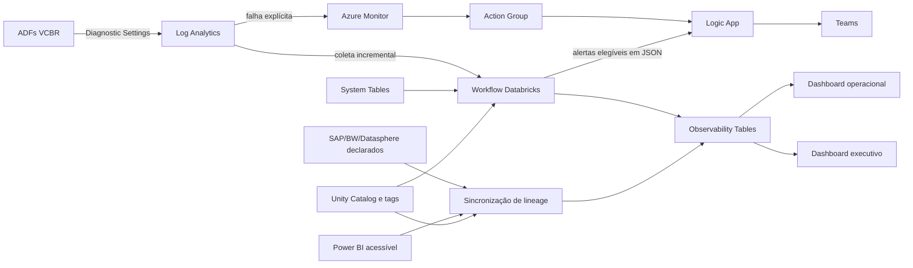
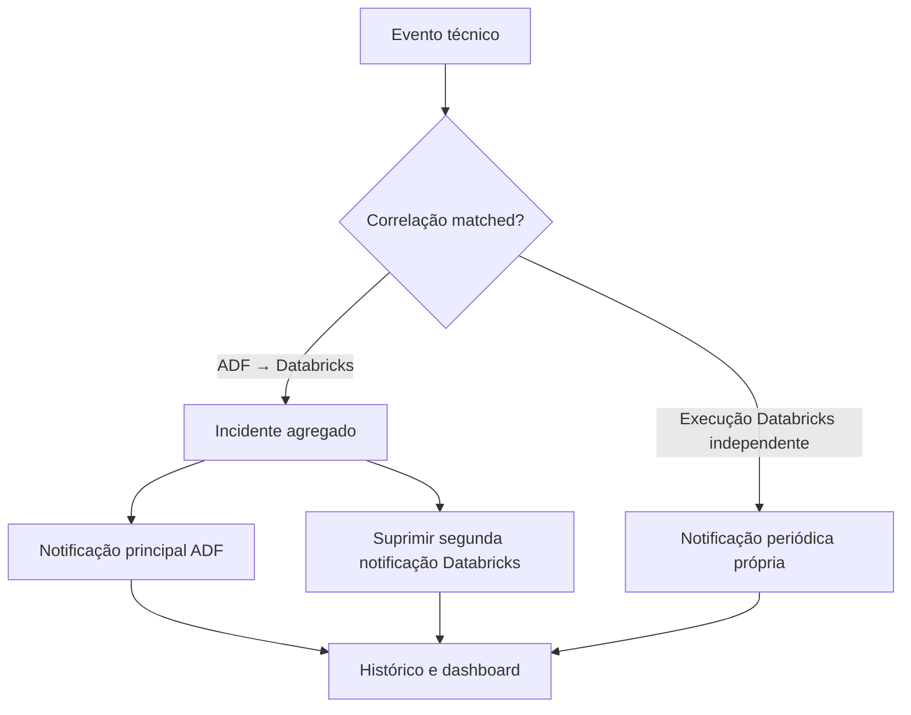

# Arquitetura de referência

## Fluxos de execução



Há três cadências independentes:

1. **Resposta rápida:** falhas explícitas ADF são avaliadas pelo Azure Monitor e não aguardam Databricks.
2. **Ciclo operacional:** Databricks coleta, consolida, mede freshness e volume, correlaciona execuções, avalia DQ e envia alertas elegíveis a cada 30–60 minutos.
3. **Lineage:** sincronizações Databricks, SAP/BW/Datasphere e Power BI executam uma ou duas vezes ao dia.

## Responsabilidade dos componentes

| Componente | Responsabilidade |
|---|---|
| Azure Monitor | Métricas e alertas operacionais imediatos do ADF |
| Log Analytics | Telemetria recente do ADF, KQL e troubleshooting |
| Logic App | Validar e formatar payloads e enviar mensagens ao Teams |
| Databricks System Tables | Definições, jobs, tasks, pipelines, execuções e lineage nativo |
| `DESCRIBE DETAIL` | `lastModified`, `sizeInBytes`, `numFiles` e `createdAt` dos ativos monitorados |
| Unity Catalog | Inventário, tags, ownership, constraints e lineage interno |
| Observability Tables | Histórico integrado, eventos, incidentes, métricas e consumo analítico |
| Power BI Premium | Dashboards operacional e executivo |
| Git + CI/CD | Fonte única, validação e publicação das configurações YAML |

## Coleta ADF

- Inventariar todos os ADFs do `RG-ANALYTICS-VCBR`; o domínio vem do recurso ADF, não do nome do pipeline.
- Habilitar `PipelineRun`, `ActivityRun` e `TriggerRun` em Diagnostic Settings.
- Usar alerta métrico quando o sinal for suficiente e Scheduled Query Rule quando filtros ou contexto de log forem necessários.
- A referência observada em 31 dias foi 71.881 eventos de pipeline, 530.247 de atividade e 18.976 de gatilho, cerca de 4,5 GB/mês antes de margem; o MVP deve substituir bytes por evento por medição real.
- Parâmetros, entradas, saídas e mensagens de erro devem passar por avaliação de sensibilidade antes da persistência.

## Coleta Databricks

- Fontes primárias: `system.lakeflow.jobs`, `job_tasks`, `job_run_timeline`, `job_task_run_timeline`, `pipelines`, `pipeline_update_timeline`, `system.access.table_lineage` e fontes habilitadas de MLflow, serving, billing, audit e DQ.
- Filtrar workspaces pelo identificador estável retornado por `dev_it.corp_curated.vw_vc_workspaces` ou `prd_it.corp_curated.vw_vc_workspaces`.
- Um workspace incluído entra automaticamente no próximo ciclo; um removido deixa de gerar novas coletas sem perder histórico; indisponibilidade da view interrompe o processamento para evitar extrapolar o escopo.
- Usar microbatch, watermark persistido, janela de sobreposição e `MERGE` por chaves naturais.
- Executar coleta, freshness, correlação, DQ e alertas no mesmo workflow para evitar inicializações adicionais.
- Consultar logs detalhados somente sob demanda; não os enviar continuamente ao Log Analytics.

## Correlação e incidentes

Para execuções Databricks iniciadas por ADF, extrair apenas o UUID final de `run_name`:

```regex
(?i)([0-9a-f]{8}-[0-9a-f]{4}-[0-9a-f]{4}-[0-9a-f]{4}-[0-9a-f]{12})$
```

O UUID candidato é comparado, em minúsculas, a `ADFActivityRun.ActivityRunId`. Não se inferem nomes de ADF, pipeline ou atividade por separadores textuais. Estados mínimos: `matched`, `uuid_detected_not_found`, `not_adf_pattern`, `pending_adf_arrival` e `ambiguous`.



Evento, avaliação de notificação e incidente são entidades distintas. A supressão remove ruído, não evidência. Retries, reruns, jobs multitarefa, múltiplos ADFs e diferença de chegada entre fontes devem ser testados.

## Alertas como código

Estrutura lógica mínima:

```text
alerts/
├── context/environments.yaml
├── adf/{common,dominio}.yaml
├── databricks_execution/{common,dominio}.yaml
├── data_quality/{dominio}.yaml
└── schema/alert-rule.schema.json
```

Cada regra declara explicitamente domínio e equipe responsável. O pipeline descobre `alerts/**/*.yaml`, valida sintaxe, schema, aliases, severidade, frequência, janela, sinal, escopo, KQL e ausência de segredos. Os modos são `validate`, `plan` e `apply`. O mesmo commit aprovado alimenta duas pernas: regras ADF no Azure Monitor e sincronização das regras Databricks/DQ na Git Folder. Falha de uma perna invalida a publicação completa. Remoções exigem aprovação e alterações manuais aparecem como drift.

## Lineage federado

- **SAP/BW/Datasphere → Databricks:** construir objetos externos e relações a partir de `vc_source_system` e `vc_source_object`. A evidência é `declared`.
- **ADF → Databricks:** derivar a relação das execuções correlacionadas.
- **raw → cleansed → curated:** usar lineage nativo do Unity Catalog quando a operação for capturável.
- **Databricks → Power BI:** executar PoC com Scanner/Admin APIs e avaliar `lineage-syncer` como acelerador, não como dependência previamente aprovada.

Sincronizadores usam identidade determinística, `upsert`, reconciliação de estado desejado, período de carência antes de exclusão, auditoria e proteção de objetos não gerenciados. Uma ausência por falha de API ou permissão não prova remoção.

## Segurança e operação

- Identidades de implantação e coleta usam menor privilégio; jobs usam service principal e nenhum token pessoal fica em código.
- Segredos ficam no Key Vault ou mecanismo corporativo equivalente.
- O acesso ao catálogo `system`, à view de workspaces e às tabelas de governança é controlado por função.
- A coleta Power BI usa identidade aprovada e somente os metadados necessários.
- A própria solução monitora atraso, watermark, linhas lidas/inseridas/atualizadas/rejeitadas, taxa de correlação, entrega de notificações, custo do Log Analytics, atualização de dashboards e drift de configuração.
