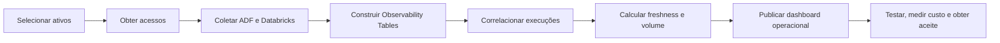

# Plano de entrega e operação

## Prioridades

- **P0 — núcleo obrigatório:** escopo e acessos, ADF, Observability Tables, coleta Databricks, correlação, eventos, notificações, freshness, volume, dashboard operacional, testes, custos e aceite.
- **P1 — demonstração dos cinco pilares:** schema, Data Quality, Health Score, dashboard executivo e PoCs de lineage federado.
- **P2 — opcional:** amostra MLOps de até três workloads.

Com 1,5 FTE, P2 e componentes P1 que dependam de autorizações externas não podem atrasar o núcleo P0.

## Marcos de 90 dias

| Período | Entregas predominantes | Marco verificável |
|---|---|---|
| Dias 1–15 | Patrocínio, dez ativos, responsáveis, processos, tags, critérios de aceite, inventário ADF/Databricks e matriz de acesso | Escopo, identidades, acessos e baseline aprovados |
| Dias 16–30 | Log Analytics, retenção, Diagnostic Settings, Action Group, Logic App, teste ADF → Teams e estrutura física das tabelas | Telemetria ADF e primeiro alerta ponta a ponta |
| Dias 31–45 | Coleta ADF/Databricks, watermarks, idempotência, métricas do coletor e correlação | Histórico integrado e contexto ADF–Databricks |
| Dias 46–60 | YAML/CI/CD, regras mínimas, freshness, volume, eventos, incidentes e dashboard operacional | Operação e alertas governados disponíveis |
| Dias 61–75 | Schema, DQ, Health Score, dashboard executivo e início das PoCs de lineage | Cinco pilares demonstráveis e cobertura explícita |
| Dias 76–90 | Lineage, MLOps opcional, testes finais, custos, runbook, backlog e recomendação | MVP aceito e decisão de continuidade sustentada |

## Caminho crítico

Alertas como código evoluem em paralelo após o primeiro alerta controlado. O modelo físico pode começar em paralelo à criação do Log Analytics, mas a implementação final depende da validação dos schemas reais. As trilhas SAP e Power BI também podem ocorrer em paralelo e não bloqueiam o dashboard operacional.

## Sequência técnica mínima

1. Confirmar patrocinador, equipe, dez ativos, responsáveis, criticidade, periodicidade, consumidores e baseline.
2. Inventariar ADFs, mapear domínio por recurso, validar a view de workspaces e levantar acessos e controles existentes.
3. Criar Log Analytics, configurar retenção e Diagnostic Settings e validar um alerta temporário ponta a ponta.
4. Aprovar nomes, campos, chaves e estados das camadas raw, cleansed e curated.
5. Implementar coletas incrementais ADF e Databricks, watermarks, sobreposição, `MERGE` e métricas internas.
6. Implementar correlação, agrupamento de incidentes e supressão da segunda notificação.
7. Definir schema YAML, validações, gerador e pipeline de publicação nos dois destinos.
8. Implantar freshness, volume, schema, DQ, lineage interno e Health Score conforme prioridade.
9. Publicar dashboards, executar PoCs federadas, medir custos, documentar operação e obter aceite.

## Papéis

| Papel | Responsabilidade |
|---|---|
| Data Owner | Criticidade, expectativa, prioridade e aceitação de risco |
| Data Steward | Definições, regras de negócio, qualidade e curadoria de metadados |
| Engenharia de Dados VC | Instrumentação, sustentação, recuperação e correção técnica |
| Arquitetura VC | Padrões, decisões e evolução tecnológica |
| CoE SAP/VSA | Administração e governança das fontes SAP compartilhadas |
| CoE Power BI | Administração do tenant e autorizações de API |
| Equipe Control-M | Orquestração global e monitoração 24×7 dos processos críticos |

## Custos e esforço a medir

| Grupo | Direcionadores |
|---|---|
| Log Analytics | GB por categoria, retenção, consultas e alertas de log |
| Azure Monitor | Regras métricas, Scheduled Query Rules, frequência e séries |
| Databricks | Inicialização, ciclo periódico, minuto reservado para `DESCRIBE DETAIL`, escrita Delta, SQL Warehouse, DQM e consultas |
| Integrações | Logic App, Teams, APIs e sincronizações de lineage |
| Pessoas | Implementação, sustentação, onboarding, regras, incidentes e evolução |

Cada parcela de inicialização, consulta, escrita e atualização deve ser medida separadamente. O baseline observado de ADF e o benchmark de freshness servem somente para planejamento inicial; o piloto substitui premissas por consumo real.

## Critérios para a decisão pós-MVP

Avaliar plataforma especializada quando uma ou mais condições forem comprovadas:

- cobertura crítica permanece abaixo de 80%;
- sustentação ou onboarding é incompatível com a equipe;
- causa raiz exige cruzamento manual recorrente;
- lineage SAP–Databricks–Power BI é insuficiente para auditoria;
- surgem requisitos multicloud, multiempresa, segurança ou compliance não atendidos;
- MTTD ou MTTR permanecem acima das metas;
- anomalias avançadas ou RCA automática tornam-se requisitos;
- custo interno se aproxima do licenciamento gerenciado.

## Backlog posterior

ServiceNow, Event Hub, contratos ODCS, lineage externo em escala, integração corporativa SAP/Purview, anomalias multivariadas, RCA assistida/automática, drift e performance avançada de modelos, runbooks automatizados, expansão para outras regiões e avaliação de solução multicloud.
