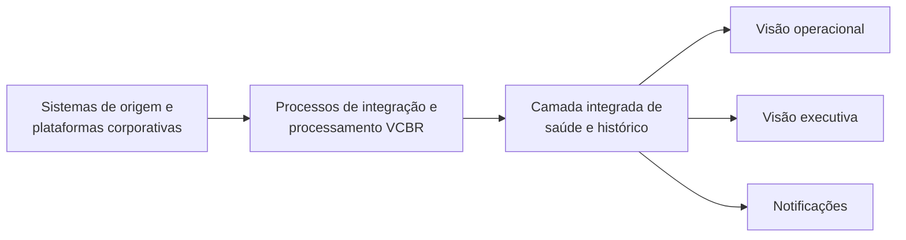

# Arquitetura conceitual

## Votorantim Cimentos — MVP VCBR

| Item | Definição |
|---|---|
| Tipo | Visão executiva e solução conceitual |
| Público | Liderança, áreas de negócio, governança, arquitetura e equipes de dados |
| Escopo inicial | VCBR |
| Horizonte do MVP | 90 dias |
| Capacidade considerada | 1,5 FTE |
| Documento complementar | [Desenho técnico de referência](desenho-tecnico-referencia.md) |

---

## 1. Visão executiva

A Votorantim Cimentos depende de dados para acompanhar suas operações, orientar decisões e produzir informações gerenciais. Entretanto, os sinais que indicam se esses dados estão disponíveis, completos e confiáveis encontram-se distribuídos entre diferentes plataformas e equipes.

Hoje não existe uma visão unificada que permita responder, de maneira simples:

- quais processos deveriam ter executado e não executaram;
- quais cargas falharam;
- quais dados chegaram atrasados;
- quais tabelas receberam uma quantidade inesperada de registros;
- quais estruturas foram alteradas;
- quais regras de qualidade foram violadas;
- quais relatórios e produtos podem ser afetados;
- quem deve analisar e decidir sobre o problema.

Uma falha técnica explícita é apenas parte do problema. Existem situações em que nenhum erro é produzido, mas o dado não foi atualizado, chegou incompleto, sofreu uma variação anormal ou deixou de atender a uma regra de negócio. Esses casos podem ser descobertos somente quando um consumidor percebe uma inconsistência no Power BI ou em outro produto analítico.

Esta proposta cria uma capacidade inicial de Observabilidade de Dados para reunir essas informações, antecipar problemas e mostrar a saúde dos dados por ativo, produto e domínio. A implementação começará por um conjunto pequeno de ativos VCBR, permitindo comprovar valor, esforço e custo antes da ampliação ou da aquisição de uma plataforma corporativa multicloud.

## 2. Cenário atual

### 2.1 Ambiente distribuído

O fluxo de dados da VCBR atravessa diferentes plataformas:

- sistemas corporativos de origem, incluindo SAP S/4HANA, BW e Datasphere;
- orquestração de processos e dependências críticas;
- Data Factories do ambiente corporativo da VCBR;
- ambientes Databricks para processamento e Lakehouse;
- Unity Catalog para governança dos dados;
- Power BI para consumo analítico;
- plataformas de treinamento e disponibilização de modelos de Machine Learning.

Cada plataforma possui mecanismos próprios de acompanhamento. Esses mecanismos são úteis para suas operações locais, mas não formam uma visão única da jornada do dado.

### 2.2 Lacunas de acompanhamento

Os principais cenários que a solução deve ajudar a identificar são:

1. **Processo esperado que não executou.** Uma carga deveria ocorrer em determinado horário, mas não existe execução ou atualização correspondente.
2. **Falha explícita.** Um pipeline, atividade ou processamento terminou com erro.
3. **Atraso.** O processo concluiu, mas depois do prazo necessário ao negócio.
4. **Carga vazia ou parcial.** O processo terminou tecnicamente com sucesso, porém nenhum registro ou apenas parte do volume esperado foi carregado.
5. **Variação anormal.** A quantidade de registros aumentou ou diminuiu de maneira incompatível com o comportamento habitual.
6. **Duplicidade.** Um reprocessamento ou erro de lógica inseriu registros repetidos.
7. **Mudança estrutural.** Uma coluna foi removida, renomeada ou teve seu tipo alterado, afetando consumidores.
8. **Violação de regra de negócio.** O dado existe, mas não atende a critérios de validade, completude, unicidade ou consistência.
9. **Impacto desconhecido.** Uma falha ocorre e a equipe não consegue identificar rapidamente quais tabelas, modelos ou relatórios dependem daquele dado.
10. **Responsabilidade indefinida.** O problema é detectado, mas não está claro quem deve avaliar seu impacto funcional.

### 2.3 Consequências

As lacunas atuais podem resultar em:

- descoberta tardia de problemas pelos consumidores;
- decisões baseadas em dados desatualizados ou incompletos;
- retrabalho da Engenharia de Dados;
- investigação manual em várias plataformas;
- aumento do tempo de detecção e recuperação;
- perda de confiança nos produtos de dados;
- dificuldade de justificar investimentos em observabilidade.

## 3. Contexto organizacional e limitações

### 3.1 Estrutura corporativa

A Votorantim Cimentos é uma multinacional com atuação global. Para esta proposta são relevantes a VCBR, no Brasil, a VCNA, a Itacamba e a VCEAA, na Europa.

A VCBR integra o grupo Votorantim, cuja holding também possui outras empresas, como Nexa e CBA. Algumas plataformas corporativas são compartilhadas entre países e empresas e, por isso, não são administradas diretamente pela equipe de Dados da Votorantim Cimentos.

### 3.2 SAP S/4HANA, BW e Datasphere

S/4HANA, BW e Datasphere possuem dados de VCBR, VCNA, Itacamba e outras empresas do grupo. Esses ambientes e sua governança são administrados pelo CoE da VSA.

A Votorantim Cimentos não pode alterar unilateralmente essa governança nem instrumentar livremente essas plataformas. A solução deverá trabalhar com as informações disponíveis e registrar, nas tabelas da VC, o sistema e o objeto de origem quando conhecidos.

O objetivo não é governar o SAP, mas responder, por exemplo, que determinada tabela da VC foi extraída de um objeto específico do BW ou Datasphere. Essa informação poderá complementar o histórico de transformação observado dentro do ambiente Databricks.

### 3.3 Power BI

O tenant do Power BI é administrado pelo CoE. A VC não possui acesso administrativo ao tenant, mas existe um processo corporativo estabelecido no qual os workspaces da empresa incluem um grupo administrativo da VC. Os workspaces antigos conhecidos também receberam esse grupo.

A obtenção de lineage e metadados dependerá desse processo já existente. A proposta não pretende redefini-lo.

As principais limitações são:

- a cobertura ficará restrita aos workspaces acessíveis à VC;
- workspaces fora do processo conhecido podem não ser descobertos;
- acesso administrativo ao workspace pode não ser suficiente para todas as interfaces administrativas do tenant;
- informações adicionais podem depender de autorização do CoE;
- a cobertura será medida sobre o universo VCBR conhecido e acessível, não sobre todo o tenant.

### 3.4 Control-M

O Control-M é administrado por outra empresa do grupo e é utilizado para processos críticos que exigem monitoração 24×7 ou coordenação entre sistemas distintos, como uma execução que depende de um processamento SAP.

No cenário atual, o Control-M dispara processos no ADF. A observabilidade acompanhará a execução a partir do momento em que ela chegar ao ambiente da VC. Se o Control-M falhar antes de iniciar o processo, o tratamento continuará sob responsabilidade de sua monitoração 24×7.

É aceitável que Control-M e observabilidade produzam notificações para o mesmo problema. Os dois mecanismos possuem objetivos e públicos operacionais distintos.

### 3.5 Consequência para a solução

A observabilidade será federada. Ela terá maior profundidade nos ambientes administrados pela VC e cobertura parcial ou declarada nos ambientes externos.

O documento distinguirá sempre:

- informação capturada automaticamente;
- informação correlacionada entre execuções;
- informação declarada por metadados;
- informação importada de uma plataforma externa;
- informação ainda indisponível.

## 4. O que é Observabilidade de Dados

Observabilidade de Dados é a capacidade de compreender continuamente a saúde dos dados e de investigar rapidamente o que ocorreu quando essa saúde se degrada.

Ela deve permitir responder:

- o dado está atualizado?
- a quantidade recebida faz sentido?
- a estrutura continua compatível?
- o conteúdo atende às regras esperadas?
- de onde o dado veio e quem depende dele?

Observabilidade é mais ampla que monitoramento técnico. O monitoramento informa, por exemplo, que um pipeline terminou com sucesso ou falhou. A observabilidade procura determinar se o resultado desse pipeline produziu o dado correto, no momento esperado, com o volume adequado e sem afetar consumidores.

```text
Monitoramento técnico
        +
Saúde e comportamento dos dados
        +
Contexto, responsabilidade e impacto
        =
Observabilidade de Dados
```

## 5. Os cinco pilares

### 5.1 Freshness — atualidade

Avalia se o dado foi disponibilizado no prazo esperado.

Exemplos:

- uma tabela diária ainda não foi atualizada;
- uma carga terminou depois do horário necessário ao relatório;
- a última data de negócio é anterior à data esperada.

### 5.2 Volume

Avalia se a quantidade processada está coerente com a expectativa.

Exemplos:

- uma carga trouxe zero registros;
- o volume caiu 40% em relação ao comportamento habitual;
- a quantidade na origem e no destino é diferente;
- um reprocessamento duplicou os registros.

### 5.3 Schema — estrutura

Avalia se a estrutura do dado mudou de forma compatível e autorizada.

Exemplos:

- uma coluna foi removida;
- um tipo de dado foi alterado;
- uma coluna obrigatória passou a aceitar valores nulos;
- uma mudança quebrou um relatório ou processamento downstream.

### 5.4 Data Quality — qualidade

Avalia se o conteúdo atende às regras técnicas e de negócio.

Dimensões usuais:

- completude;
- unicidade;
- validade;
- consistência;
- integridade referencial;
- reconciliação;
- acurácia, quando houver uma referência confiável.

### 5.5 Lineage — linhagem

Representa a origem, as transformações e os consumidores do dado.

O lineage permite analisar impacto e acelerar a investigação. No contexto da VC, ele deverá combinar:

- origem SAP/BW/Datasphere declarada;
- execução observada no ADF;
- transformações internas capturadas no Databricks;
- consumo conhecido nos workspaces Power BI acessíveis.

Lineage não exige a mesma frequência dos sinais operacionais. Para o MVP, sua atualização poderá ocorrer uma ou duas vezes ao dia, em processo independente do ciclo de observabilidade de 30–60 minutos. Essa cadência é suficiente para inventário, análise de impacto e investigação, além de reduzir consumo desnecessário de APIs e processamento.

## 6. Objetivos e benefícios esperados

### 6.1 Objetivo geral

Implantar uma capacidade mínima e evolutiva de Observabilidade de Dados que reúna sinais operacionais e de qualidade, forneça visibilidade aos diferentes públicos e produza evidências para a decisão entre evolução interna e aquisição de uma plataforma especializada.

### 6.2 Benefícios

- Detectar problemas antes que sejam percebidos pelos consumidores.
- Identificar processos que deveriam executar e não executaram.
- Diferenciar falha técnica de problema no resultado dos dados.
- Reduzir o tempo de investigação.
- Priorizar incidentes conforme criticidade e impacto.
- Mostrar tendências de saúde por domínio e produto.
- Dar transparência às limitações de cobertura.
- Medir custo e esforço da solução interna.
- Apoiar uma futura decisão de investimento corporativo.

## 7. Escopo do MVP

### 7.1 Incluído

| Dimensão | Escopo inicial |
|---|---|
| Unidade | VCBR |
| Ativos | Dez ativos críticos, selecionados no início da execução |
| Processamento | Data Factories e Databricks do ambiente corporativo da VCBR |
| Camadas de dados | raw, cleansed e curated |
| Consumo | Workspaces Power BI da VC aos quais existe acesso |
| Origem externa | Identificação de fontes SAP/BW/Datasphere por metadados |
| MLOps | Pequena amostra representativa, condicionada ao esforço |
| Visualização | Visões operacional e executiva |
| Notificação | Canal corporativo simples para a primeira etapa |
| Capacidade | 1,5 FTE durante 90 dias |

### 7.2 Fora do MVP

- Cobertura global de VCNA, Itacamba e VCEAA.
- Cobertura de todo o tenant Power BI.
- Alterações na governança de SAP, Power BI ou Control-M.
- Integração automática com o processo corporativo de chamados.
- Observabilidade completa de todos os ativos da VCBR.
- Detecção avançada multivariada e causa raiz automática.
- Observabilidade completa de drift e performance de modelos.
- Implantação de uma plataforma corporativa multicloud.

## 8. Indicadores e fórmulas de cálculo

Os indicadores abaixo formam o catálogo inicial. As metas definitivas deverão ser calibradas com o histórico do piloto e com a criticidade de cada ativo.

### 8.1 Indicadores de Freshness

| Indicador | Definição | Fórmula |
|---|---|---|
| Conformidade de freshness | Percentual de ativos atualizados dentro do prazo | `ativos dentro do SLA ÷ ativos avaliados × 100` |
| Atraso de disponibilização | Tempo entre o prazo esperado e a disponibilização real | `horário real de disponibilidade − horário limite` |
| Idade do dado | Tempo transcorrido desde a última atualização válida | `horário atual − horário da última atualização` |
| Freshness de negócio | Idade do registro de negócio mais recente | `horário de referência − maior data de negócio válida` |
| Processos esperados não executados | Quantidade de execuções esperadas sem evidência de execução | `MAX(0; execuções esperadas − execuções identificadas)` |

Um atraso menor ou igual a zero indica cumprimento do prazo. O cálculo baseado na data de negócio deverá ser usado quando o horário técnico de atualização não representar a atualidade real do conteúdo.

### 8.2 Indicadores de Volume

| Indicador | Definição | Fórmula |
|---|---|---|
| Variação de volume | Diferença percentual entre volume atual e referência | `(volume atual − volume de referência) ÷ volume de referência × 100` |
| Desvio absoluto de volume | Tamanho da variação, independentemente de aumento ou queda | `ABS(volume atual − volume de referência) ÷ volume de referência × 100` |
| Reconciliação origem/destino | Percentual do volume de origem representado no destino | `registros no destino ÷ registros na origem × 100` |
| Taxa de rejeição | Percentual de registros descartados ou reprovados | `registros rejeitados ÷ registros avaliados × 100` |
| Taxa de duplicidade | Percentual de registros excedentes por chave | `registros duplicados ÷ registros avaliados × 100` |

O volume de referência poderá ser a execução anterior, uma média, uma mediana histórica ou uma faixa específica do ativo. Ativos sazonais não devem usar um limite único sem considerar seu calendário.

### 8.3 Indicadores de Schema

| Indicador | Definição | Fórmula |
|---|---|---|
| Conformidade de schema | Percentual de mudanças compatíveis ou aprovadas | `mudanças compatíveis ou aprovadas ÷ mudanças detectadas × 100` |
| Mudanças não autorizadas | Alterações estruturais sem aprovação registrada | `contagem de mudanças não aprovadas` |
| Cobertura de contrato | Percentual de ativos com estrutura esperada formalizada | `ativos com contrato de schema ÷ ativos no escopo × 100` |
| Tempo de detecção de mudança | Tempo até a mudança ser identificada | `horário da detecção − horário da mudança` |

Quando nenhuma mudança ocorrer no período, a conformidade será tratada como não aplicável, e não como divisão por zero.

### 8.4 Indicadores de Data Quality

| Indicador | Definição | Fórmula |
|---|---|---|
| Taxa de aprovação de registros | Percentual de registros aprovados | `registros aprovados ÷ registros avaliados × 100` |
| Taxa de aprovação de regras | Percentual de regras atendidas | `regras aprovadas ÷ regras executadas × 100` |
| Quality Score ponderado | Resultado das regras considerando sua importância | `soma dos pesos das regras aprovadas ÷ soma dos pesos das regras executadas × 100` |
| Cobertura de qualidade | Percentual de ativos com regras mínimas implantadas | `ativos com regras ativas ÷ ativos no escopo × 100` |
| Taxa de nulidade | Percentual de valores nulos em um campo avaliado | `valores nulos ÷ registros avaliados × 100` |
| Taxa de validade | Percentual de valores que atendem ao domínio esperado | `valores válidos ÷ valores avaliados × 100` |

Pesos iniciais sugeridos para regras:

| Criticidade da regra | Peso |
|---|---:|
| Crítica | 5 |
| Alta | 3 |
| Média | 2 |
| Baixa | 1 |

### 8.5 Indicadores de Lineage e governança

| Indicador | Definição | Fórmula |
|---|---|---|
| Cobertura de lineage | Percentual de ativos com origem e destino conhecidos | `ativos com lineage mínimo ÷ ativos no escopo × 100` |
| Cobertura de lineage nativo | Percentual coberto por captura automática | `ativos com lineage nativo ÷ ativos no escopo × 100` |
| Cobertura de origem | Percentual de ativos com sistema/objeto de origem identificado | `ativos com origem identificada ÷ ativos no escopo × 100` |
| Cobertura downstream | Percentual de ativos com consumidores conhecidos | `ativos com consumidor identificado ÷ ativos no escopo × 100` |
| Cobertura de ownership | Percentual de ativos com responsável de negócio | `ativos com Data Owner ÷ ativos no escopo × 100` |

As coberturas deverão ser apresentadas por tipo de evidência: nativa, correlacionada, declarada ou importada.

### 8.6 Indicadores operacionais

| Indicador | Definição | Fórmula |
|---|---|---|
| Taxa de sucesso | Percentual de execuções concluídas com sucesso | `execuções com sucesso ÷ execuções concluídas × 100` |
| Taxa de falha | Percentual de execuções concluídas com falha | `execuções com falha ÷ execuções concluídas × 100` |
| Cumprimento de SLA | Percentual de execuções concluídas dentro da janela | `execuções dentro do SLA ÷ execuções avaliadas × 100` |
| Duração P95 | Duração abaixo da qual estão 95% das execuções | `percentil 95 das durações` |
| MTTD | Tempo médio entre o início do problema e sua detecção | `soma(horário de detecção − início do problema) ÷ incidentes` |
| MTTR | Tempo médio entre detecção e recuperação | `soma(horário de recuperação − detecção) ÷ incidentes` |
| Reincidência | Percentual de incidentes repetidos | `incidentes reincidentes ÷ incidentes totais × 100` |
| Cobertura de monitoramento | Percentual de ativos ou processos monitorados | `itens monitorados ÷ itens no escopo × 100` |

Execuções canceladas poderão ser apresentadas separadamente para não distorcer sucesso e falha. O denominador deverá ser mantido consistente ao longo do tempo.

### 8.7 Data Health Score

O Data Health Score resume os cinco pilares em uma nota de 0 a 100:

| Pilar | Peso |
|---|---:|
| Freshness | 25% |
| Volume | 20% |
| Schema | 15% |
| Data Quality | 30% |
| Lineage | 10% |

```text
Data Health Score =
    Freshness Score × 0,25
  + Volume Score × 0,20
  + Schema Score × 0,15
  + Data Quality Score × 0,30
  + Lineage Score × 0,10
```

O score será calculado primeiro por ativo e depois agregado por produto e domínio. Valores não avaliados não deverão ser convertidos automaticamente em zero; devem ser apresentados como ausência de cobertura.

Uma média alta não poderá ocultar condições graves. Independentemente do score, deverão ficar visíveis:

- ausência de dados em ativo crítico;
- violação de regra crítica;
- mudança estrutural incompatível;
- ativo crítico fora do prazo;
- produto executivo indisponível.

O score será considerado experimental durante o MVP, até que pesos, denominadores e regras de agregação sejam validados.

## 9. Modelo conceitual da solução

A solução reunirá quatro capacidades:

1. **Coletar sinais:** receber informações das execuções, atualizações e controles existentes.
2. **Relacionar informações:** associar processo, tabela, regra, produto e consumidor.
3. **Avaliar saúde:** calcular indicadores dos cinco pilares.
4. **Comunicar:** apresentar dashboards e enviar notificações adequadas ao tipo de problema.



### 9.1 Sistemas externos e federados

SAP, Power BI e Control-M participarão conforme os acessos e processos existentes. A solução não dependerá de controlar essas plataformas para começar a gerar valor.

### 9.2 Ambientes sob atuação direta da VC

Os Data Factories e ambientes Databricks corporativos da VCBR fornecerão os principais sinais operacionais. O Unity Catalog fornecerá metadados, responsabilidades e lineage interno.

### 9.3 Camada integrada de observabilidade

Uma camada histórica reunirá os sinais de execução e de saúde dos dados. Ela permitirá comparar períodos, calcular indicadores e manter evidências para análise e auditoria.

### 9.4 Comunicação

Problemas operacionais que podem ser identificados imediatamente não deverão esperar a atualização periódica dos dashboards. As notificações rápidas e as análises históricas terão fluxos distintos.

## 10. Alertas, dashboards e tratamento de eventos

### 10.1 Duas velocidades

**Resposta rápida:** falhas técnicas explícitas do ADF poderão gerar notificação assim que forem identificadas pelo Azure Monitor.

**Avaliação periódica:** o processo de coleta e consolidação Databricks poderá avaliar, em ciclos de 30 a 60 minutos, falhas exclusivamente Databricks, freshness, volume, qualidade, cobertura e Health Score. Alertas elegíveis serão registrados no histórico e encaminhados à Logic App.

### 10.2 Falha ADF–Databricks

Quando um processamento Databricks iniciado pelo ADF falhar:

- a falha continuará visível no dashboard como evidência técnica;
- ela será relacionada à execução que a originou;
- uma segunda notificação Databricks será evitada;
- o problema será contado como um único incidente agregado.

Essa regra remove ruído sem eliminar informações de diagnóstico.

Execuções Databricks manuais, agendadas ou iniciadas via API, sem correlação com ADF, permanecerão elegíveis para notificação. No MVP, o próprio processo de coleta de 30–60 minutos identificará essas falhas, aplicará as regras de correlação e supressão e registrará a decisão na camada histórica antes de acionar a Logic App. Consequentemente, esse alerta será periódico, e não imediato.

As configurações funcionais de alertas ADF, Databricks e Data Quality serão versionadas em YAML em um único repositório. Cada categoria poderá conter vários arquivos organizados por domínio ou produto, por exemplo `logistics` e `people`; a identificação do domínio também deverá constar explicitamente nos metadados da regra. Para os alertas Databricks e de Data Quality, os YAML serão disponibilizados em uma Databricks Git Folder e interpretados pelo processo incremental. A comunicação com a Logic App utilizará um payload JSON padronizado, permitindo que o mesmo componente formate e encaminhe mensagens ao Teams.

Um único pipeline CI/CD validará todos os YAML e publicará o mesmo commit aprovado por duas pernas: implantação das regras ADF no Azure Monitor e sincronização da Git Folder no Databricks. Dessa forma, o repositório permanece como fonte única, embora os mecanismos de aplicação sejam diferentes.

### 10.3 Dashboard operacional

Deverá responder:

- o que está executando;
- o que falhou;
- o que está atrasado;
- quais volumes estão anormais;
- quais regras foram violadas;
- quais ativos e consumidores podem estar afetados;
- qual é a evidência técnica relacionada.

### 10.4 Dashboard executivo

Deverá apresentar:

- Data Health Score;
- cumprimento de prazo;
- ativos saudáveis, em atenção e críticos;
- incidentes e recorrência;
- cobertura de monitoramento e qualidade;
- cobertura de lineage por tipo de evidência;
- evolução por domínio e produto.

## 11. Modelo operacional federado

| Papel | Responsabilidade principal |
|---|---|
| Data Owner | Criticidade, expectativa de atualização, prioridade e aceitação de risco |
| Data Steward | Definições, qualidade, regras de negócio e curadoria de metadados |
| Engenharia de Dados VC | Instrumentação, acompanhamento, recuperação e correção técnica |
| Arquitetura VC | Padrões, evolução da solução e avaliação tecnológica |
| CoE SAP/VSA | Administração e governança das plataformas SAP compartilhadas |
| CoE Power BI | Administração do tenant e autorizações necessárias |
| Equipe Control-M | Orquestração global e monitoração 24×7 de processos críticos |

A solução não redefinirá processos já estabelecidos pelos CoEs. Ela registrará as dependências relevantes, a responsabilidade conhecida e as limitações de cobertura.

## 12. Cenários de evolução

### 12.1 Cenário A — MVP com capacidades existentes

Utiliza os recursos já disponíveis nas plataformas corporativas para criar uma visão integrada mínima.

**Vantagens:** menor investimento inicial, aprendizado rápido e evidências reais para decisão.

**Limitações:** maior esforço interno, lineage parcial entre plataformas e investigação ainda assistida por pessoas.

### 12.2 Cenário B — Ampliação da solução interna

Adiciona maior automação, menor latência e mais integrações conforme a necessidade comprovada.

**Quando considerar:** crescimento expressivo de volume, necessidade de respostas em poucos minutos ou integração de muitas novas fontes.

### 12.3 Cenário C — Plataforma corporativa especializada

Adota uma solução multicloud com maior cobertura automática, correlação e gerenciamento de incidentes.

**Quando considerar:** escala incompatível com a equipe, lineage corporativo certificado, requisitos regulatórios, causa raiz automatizada ou custo interno elevado.

## 13. Recomendação para o MVP

Executar o Cenário A de forma limitada e mensurável. O MVP deverá priorizar:

1. inventário e responsabilidades dos dez ativos;
2. processos esperados, falhas e atrasos;
3. correlação entre orquestração e processamento;
4. freshness e volume;
5. regras mínimas de qualidade;
6. visão operacional;
7. visão executiva e Health Score experimental;
8. PoCs de lineage SAP e Power BI;
9. mensuração de custo e esforço.

A observabilidade básica de MLOps poderá incluir até três exemplos representativos: treinamento, disponibilização de modelo e um cenário em Azure ML. Ela será reduzida ou adiada se comprometer o núcleo do MVP.

## 14. Cronograma de 90 dias

### Dias 1–30 — Entendimento e fundação

- selecionar os dez ativos;
- identificar processos, responsáveis, criticidade e expectativas de atualização;
- inventariar os ambientes corporativos VCBR em escopo;
- estabelecer a coleta dos sinais operacionais;
- definir a camada histórica de observabilidade;
- validar a correlação entre as execuções;
- definir o padrão de alertas configuráveis e versionados.

**Resultado esperado:** inventário confiável, responsabilidades conhecidas e primeiros sinais operacionais disponíveis.

### Dias 31–60 — Visibilidade operacional

- disponibilizar notificações iniciais;
- implementar freshness e volume;
- correlacionar falhas entre as plataformas;
- publicar a primeira visão operacional;
- medir latência, cobertura e custo reais;
- iniciar regras mínimas de qualidade.

**Resultado esperado:** falhas e atrasos visíveis, com redução da investigação manual.

### Dias 61–90 — Saúde dos dados e decisão

- ampliar regras de qualidade para os ativos piloto;
- acompanhar mudanças estruturais;
- calcular o Health Score experimental;
- publicar a visão executiva;
- executar PoCs de lineage SAP e Power BI;
- incluir MLOps básico se houver capacidade;
- registrar lacunas, custos e esforço;
- recomendar a próxima onda ou avaliação de ferramenta especializada.

**Resultado esperado:** solução mínima demonstrada e decisão de evolução sustentada por evidências.

Com 1,5 FTE, a integridade do núcleo operacional terá prioridade. Funcionalidades das últimas semanas poderão ser reduzidas se a fundação exigir esforço superior ao previsto.

## 15. Critérios de sucesso

O MVP será considerado bem-sucedido quando:

- os ambientes corporativos em escopo fornecerem os sinais definidos;
- os dez ativos tiverem responsável, criticidade e expectativa de atualização;
- falhas explícitas forem notificadas sem depender do ciclo periódico;
- processos esperados não executados puderem ser identificados para os ativos piloto;
- execuções relacionadas forem apresentadas como um único contexto de incidente;
- falhas técnicas continuarem disponíveis para investigação;
- freshness e volume forem medidos para os ativos piloto;
- o dashboard operacional mostrar falhas, atrasos e anomalias;
- o dashboard executivo mostrar saúde, cobertura e tendência;
- as limitações de lineage SAP e Power BI forem demonstradas com transparência;
- custo e esforço de sustentação forem mensurados.

Metas definitivas de SLA e qualidade deverão ser aprovadas após o baseline do piloto.

## 16. Direcionadores de custo

Os valores serão calculados em etapa própria. A avaliação deverá considerar:

- volume e retenção dos sinais operacionais;
- quantidade e frequência de regras de alerta;
- processamento e armazenamento da camada histórica;
- atualização dos dashboards;
- notificações;
- obtenção de metadados do Power BI;
- segurança e identidades;
- desenvolvimento e sustentação em FTE;
- licenciamento de eventual ferramenta especializada.

A planilha `Cen1-Custos_Azure_Observabilidade.xlsx` será utilizada como referência de volumetria, com validação das premissas durante o MVP.

## 17. Riscos e dependências

| Risco ou dependência | Tratamento |
|---|---|
| Capacidade limitada a 1,5 FTE | Manter dez ativos e priorizar o núcleo operacional |
| Metadados incompletos | Corrigir durante o onboarding dos ativos piloto |
| Permissões Power BI insuficientes | PoC e solicitação pontual ao CoE |
| Lineage SAP inicialmente declarado | Mostrar claramente o tipo de evidência |
| Processos esperados sem calendário confiável | Formalizar expectativa junto ao responsável do ativo |
| Limites de volume definidos sem histórico | Calibrar após coleta de baseline |
| Excesso de notificações | Agrupamento, criticidade e revisão periódica |
| Dependência de recursos ainda em evolução | Não utilizá-los como único controle de ativos críticos |
| Sustentação interna maior que a capacidade | Usar resultado do MVP para decisão de aquisição |

## 18. Critérios para ampliar ou adquirir uma solução

A avaliação de uma plataforma especializada deverá considerar:

- cobertura real obtida pelo MVP;
- esforço mensal de sustentação;
- tempo para incluir um novo ativo;
- MTTD e MTTR;
- lacunas de lineage;
- necessidade multicloud e multiempresa;
- segurança e segregação;
- requisitos regulatórios;
- automação de detecção e causa raiz;
- custo total interno comparado ao licenciamento.

Uma aquisição passa a ser recomendável quando as limitações da solução interna forem mensuráveis e relevantes, e não apenas porque uma ferramenta oferece mais funcionalidades.

## 19. Decisões consolidadas

1. O MVP será restrito à VCBR e a dez ativos.
2. O escopo tecnológico abrangerá os Data Factories e Databricks do ambiente corporativo da VCBR.
3. O histórico será separado do mecanismo de resposta rápida.
4. A visão analítica poderá operar em ciclos de 30–60 minutos.
5. Falhas explícitas do ADF poderão gerar notificação imediata; falhas exclusivamente Databricks serão avaliadas no ciclo de 30–60 minutos.
6. Teams será o canal inicial; integração automática com chamados fica fora do MVP.
7. Configurações de alerta serão versionadas em múltiplos YAML por categoria e domínio em um único repositório; o mesmo pipeline implantará as regras ADF no Azure Monitor e sincronizará a Databricks Git Folder, enquanto a integração com a Logic App utilizará JSON.
8. Control-M não será integrado como fonte e suas notificações poderão coexistir com as da observabilidade.
9. Falhas de processamento correlacionadas permanecerão no dashboard mesmo quando a segunda notificação for suprimida.
10. SAP será representado por metadados de origem, respeitando a governança do CoE.
11. Power BI será coberto apenas nos workspaces acessíveis pelo processo já estabelecido.
12. MLOps será uma amostra opcional e não terá prioridade sobre o núcleo de dados.
13. As atualizações de lineage serão executadas uma ou duas vezes ao dia e não acompanharão o ciclo operacional de 30–60 minutos.
14. A decisão de compra será tomada após medir cobertura, custo e esforço.

---

## Conclusão

A proposta parte do problema de negócio: a VC precisa saber se os dados esperados foram produzidos, se chegaram no prazo, se possuem volume e qualidade adequados e quais consumidores podem ser afetados.

O contexto corporativo impede uma visão totalmente automática de ponta a ponta no primeiro momento, porque partes importantes do fluxo são administradas por outros CoEs. A solução reconhece essa realidade e combina evidências automáticas, correlações e metadados declarados sem apresentar cobertura parcial como completa.

O MVP cria uma base de aprendizado com escopo compatível com 1,5 FTE. Ao final dos 90 dias, a Votorantim Cimentos deverá possuir melhor visibilidade operacional, indicadores de saúde dos dados e informações concretas para decidir entre ampliar a solução interna ou avançar para uma plataforma corporativa especializada.
